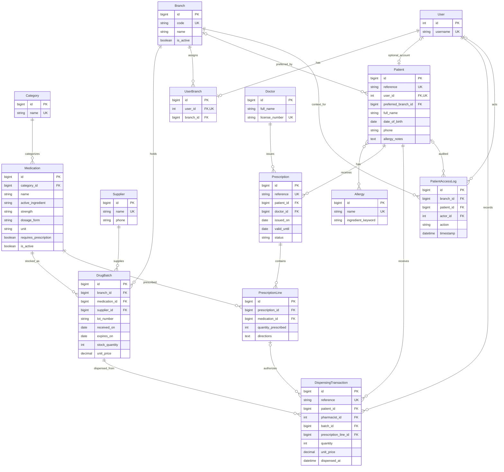

# Pharmacy IS relational model

The Mermaid ER diagram shows the application’s branch, patient and inventory relationships. Every entity uses `id` as its PK. User represents Django accounts.

Composite unique keys: Medication(name, strength, dosage_form), DrugBatch(branch_id, medication_id, lot_number), and PrescriptionLine(prescription_id, medication_id). Each dispensing location is derived from the referenced batch.
