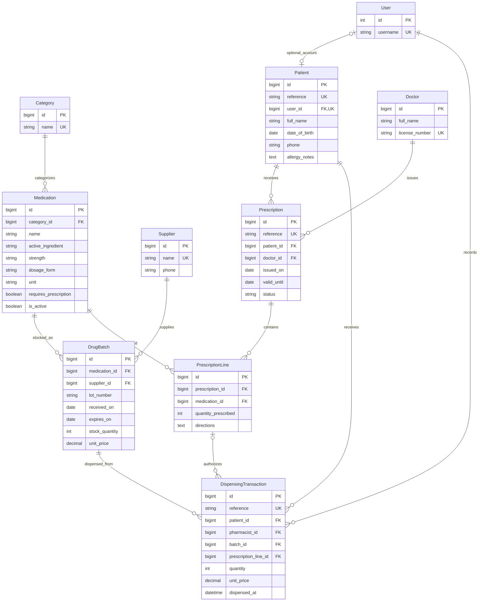

# Pharmacy IS relational model

The Mermaid ER diagram below corresponds to the initial Django migration. Every entity uses `id` as its PK. Django's authentication tables are represented by User; its existing groups and permissions are omitted for readability.

Composite unique keys: Medication(name, strength, dosage_form), DrugBatch(medication_id, lot_number), PrescriptionLine(prescription_id, medication_id). A prescription may have zero lines while being drafted; the later dispensing workflow must reject empty prescriptions.
